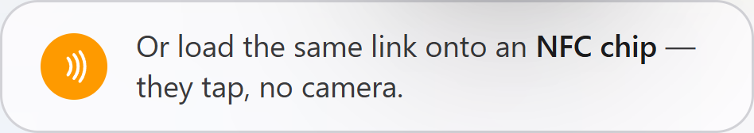
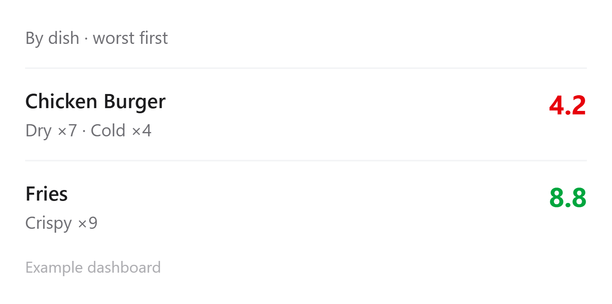
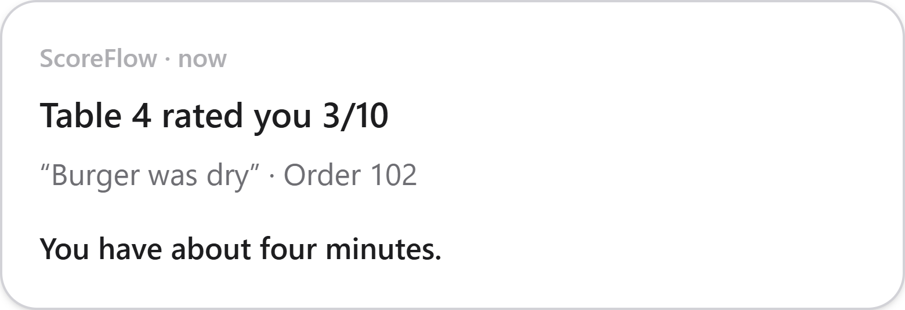
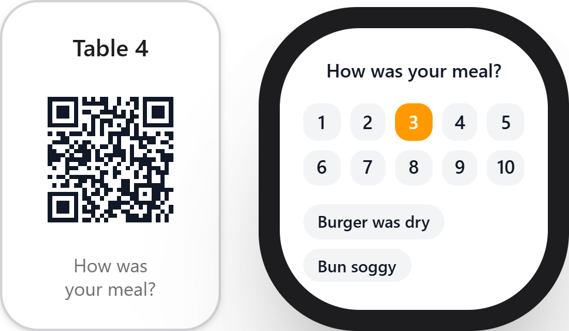

# ScoreFlow

**Catch an unhappy diner while they're still at the table — and know which dish it was.**

A multi-tenant meal-feedback app for restaurants. A guest scans the card on their table,
rates the meal out of ten, and taps what was wrong. If the score is low, the owner's phone
buzzes within seconds — while the guest is still sitting there, still holding the bill.

Next.js 16 · React 19 · TypeScript · Prisma 7 · PostgreSQL · Tailwind 4

---

## The problem it solves

An unhappy guest almost never complains at the table. They say "fine, thanks", leave, and
write a one-star review three days later — when nothing can be done about it. The restaurant
learns about a bad meal from Google, in public, too late.

ScoreFlow moves that moment forward. The feedback arrives while the guest is still in the
room, and it is specific enough to act on: not "someone was unhappy", but *"the chicken
burger was dry, table 7, order 1042"*.

## How it works

1. **A card on the table.** The owner prints a QR kit from the app — one card per table, no
   hardware to buy. Guests can tap an NFC chip instead if they prefer.
2. **Ten seconds for the guest.** Rate 1–10, tap a suggestion or two, optionally add a
   comment. No app, no account, nothing to install.
3. **The suggestions know the menu.** Instead of a generic "food was cold", the guest is
   offered options about the dish they actually ate — "Dry patty", "Bun fell apart".
4. **The owner hears immediately.** A low score sends an email alert with the table, the
   order and what was tapped. A daily digest summarises the rest.
5. **Happy guests are invited to review.** Google, Tripadvisor, Yelp or Zomato — whichever
   the restaurant uses, and whichever the guest already has an account with.

### Knowing which dish

The suggestions get specific when ScoreFlow knows what was on the plate:

| Till | How it connects | What the guest does |
|---|---|---|
| **Square** | One click: OAuth, read-only access, no key and no developer | Types the four-character code from the bottom of their receipt (optional) |
| **Any other till** | The till posts each order to `POST /api/pos/orders` with a key the owner copies from Settings | Types their order number (optional) |
| **No till** | Nothing to do | Gets suggestions drawn from the saved menu |

The menu itself can be typed in, photographed (read by AI), or imported from Square in one
press — Square's names match what it prints on every order, so orders match dishes exactly.

### No review gating

Every guest is shown the review link, whatever they scored. Hiding it from unhappy guests —
"review gating" — breaches Google's policy and UK rules on misleading reviews, and the app
deliberately will not do it. The landing page says so openly, because a savvy owner will ask.

## What's in it

**For the guest** — one page, no login: rate 1–10, tap dish-aware suggestions, optional
comment, optional order or receipt code, and (after a poor score) the chance to leave a name
and number so the restaurant can put it right.

**For the restaurant** — a dashboard with a needs-attention worklist, a per-dish breakdown,
review-click tracking, a table manager with a printable QR kit, a menu manager with
AI-written suggestions you can reword, settings for review links and alert thresholds, and
self-service account closure.

**For a group** — one account, many locations: a console comparing branches, a manager login
per branch that sees only its own venue, a daily summary across the group, and manager
invites by email.

**For the platform operator** — customers, payments, trials, comps and suspensions, plus a
rescue tool for an owner who has lost access to their inbox. It deliberately shows **no
ratings and no comments**: the operator can see that an account is active and how many
responses it has had, and nothing a diner wrote.

## A look at it

Captured from the product's own `/pitch` page; the numbers are illustrative examples.

| The guest's screen | What the owner learns |
|---|---|
|  |  |

| The alert, seconds later | The card on the table |
|---|---|
|  |  |

## Tech stack

| Layer | Choice |
|---|---|
| Framework | Next.js 16 (App Router, Turbopack, server actions) |
| UI | React 19, Tailwind CSS 4 |
| Database | PostgreSQL (Neon), Prisma 7 with the `pg` driver adapter |
| Auth | Auth.js (NextAuth v5), credentials + bcrypt |
| Email | Nodemailer via Gmail, or log-only in development |
| AI (optional) | Google Gemini — menu photos and per-dish suggestions |
| Till integration | Square OAuth + webhooks; a signed-key webhook for everything else |
| Hosting | Vercel, with a cron job for the daily digest |

## Getting started

**You need:** Node 20+, a PostgreSQL database (Neon's free tier is fine), and Git.

```bash
git clone https://github.com/codebyrifaf/scoreflow.git
cd scoreflow
npm install

cp .env.example .env        # then fill in DATABASE_URL and AUTH_SECRET

npx prisma migrate deploy   # create the tables
npm run seed                # create the operator login (and optional demo data)
npm run dev                 # http://localhost:3000
```

Only `DATABASE_URL` and `AUTH_SECRET` are required. With no email provider configured the
app prints each message to the terminal instead of sending it, so you can watch alerts fire
without an email account. Without an AI key, dish suggestions fall back to built-in
templates — nothing is blocked.

`npm run db:where` tells you which database you are pointed at. Worth running before
anything destructive.

### Environment variables

| Variable | Required | What it does |
|---|---|---|
| `DATABASE_URL` | yes | PostgreSQL connection string (use the pooled Neon endpoint) |
| `AUTH_SECRET` | yes | Signs the session cookie |
| `IP_HASH_SALT` | recommended | Salts hashed IPs in the spam guard; falls back to `AUTH_SECRET` |
| `APP_URL` | automatic on Vercel | Base URL used in email links and QR codes |
| `EMAIL_PROVIDER` | no | `gmail` to send for real; unset logs to the terminal |
| `GMAIL_USER`, `GMAIL_APP_PASSWORD`, `EMAIL_FROM` | with Gmail | Gmail account and its 16-character App Password |
| `OPERATOR_EMAIL`, `OPERATOR_PASSWORD` | for seeding | The platform operator login |
| `CRON_SECRET` | no | Protects `GET /api/cron/digest` so only your scheduler can run it |
| `AI_PROVIDER`, `GEMINI_API_KEY` | no | `gemini` switches on menu photos and AI suggestions |
| `GEMINI_MODEL` | no | Defaults to `gemini-3.6-flash` |
| `SQUARE_ENVIRONMENT` | for Square | `sandbox` or `production` |
| `SQUARE_APPLICATION_ID`, `SQUARE_APPLICATION_SECRET` | for Square | OAuth credentials from the Square developer dashboard |
| `SQUARE_WEBHOOK_SIGNATURE_KEY`, `SQUARE_WEBHOOK_URL` | for Square | Proves an order webhook really came from Square |
| `TOKEN_ENCRYPTION_KEY` | for Square | 32 random bytes, base64 — encrypts stored Square tokens |

See [`.env.example`](.env.example) for the fully annotated list.

### Scripts

| Command | What it does |
|---|---|
| `npm run dev` | Development server |
| `npm run build` | Applies migrations, then builds for production |
| `npm run lint` | ESLint across the project |
| `npm run seed` | Creates the operator login; `SEED_DEMO=true` adds demo restaurants |
| `npm run db:where` | Prints which database `DATABASE_URL` points at |
| `npm run email:test you@example.com` | Sends one real test email through the app's own path |
| `npm run operator:set-password` | Resets the operator password |
| `npm run operator:set-login` | Changes the operator's email |

## Project structure

```
app/
  page.tsx              landing page
  r/[slug]/             one restaurant: feedback, dashboard, orders, settings, tables
  b/[brandSlug]/        multi-location console
  operator/             platform admin (no diner content, by design)
  signup, login, forgot, reset, account/close
  api/                  feedback, chips, POS orders, Square OAuth + webhook, digest cron, health
lib/                    the rules: auth guards, menu, chips, POS orders, Square, email, AI
prisma/                 schema and migrations
docs/                   owner-facing integration guide, and the POS survey
marketing/              generated sales deck and the real-UI assets it uses
scripts/                operator and database helpers
```

### The data model, briefly

A `Brand` (an account) owns `Restaurant`s (branches) and one shared `MenuItem` list. An
`Owner` is either a brand owner or a single branch's manager. `Feedback` is one guest's
submission; `PosOrder` is what the till said was on that order; `Table` carries a QR code.
Supporting tables cover `Payment`, `Operator`, `OperatorAudit`, `SquareConnection`,
`VerificationCode`, `PendingSignup` and `LoginAttempt`.

## Security and privacy

- **The token says who you are; the database says what you may see.** Every guarded page
  re-reads permissions rather than trusting the session, and a password change or an email
  rescue bumps a token version that kills every existing session immediately.
- **Writes are scoped.** A row id arriving from a browser is always paired with the
  restaurant it must belong to, so a forged id matches nothing.
- **No user enumeration.** Signup, forgot-password and resend answer identically whether or
  not an address has an account — including when email delivery is broken.
- **Rate limiting** on logins, signups and the public feedback API, with hashed, salted IPs.
- **Square tokens are encrypted at rest** (AES-256-GCM), and every Square webhook is checked
  against its HMAC signature before it is believed.
- **A restaurant's feedback is private** to that restaurant and the managers it invites. The
  operator console cannot read it.

## Deployment

Built for Vercel with a Neon database. `npm run build` runs `prisma migrate deploy` first, so
a deploy applies migrations before it serves. [`vercel.json`](vercel.json) registers the daily
digest cron (07:00 UTC). Set the same environment variables in the Vercel project.

## Status

In active development, built one milestone at a time.

- The Square integration is complete and verified end to end **against Square's sandbox**;
  going live needs production Square credentials.
- AI features are optional throughout — the product works fully without an API key.
- Prices shown on the landing page are placeholders, not a decision.

## Further reading

- [`PROJECT_OVERVIEW.md`](PROJECT_OVERVIEW.md) — architecture and conventions in depth
- [`docs/POS_INTEGRATION.md`](docs/POS_INTEGRATION.md) — the guide an owner hands to whoever runs their till
- [`marketing/README.md`](marketing/README.md) — the generated sales deck
